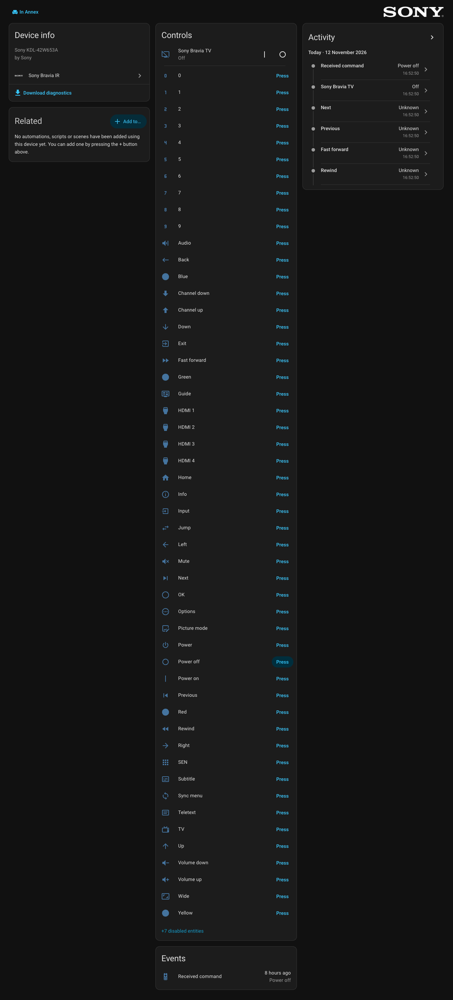

# Sony Bravia IR for Home Assistant

A Home Assistant custom integration that controls **Sony Bravia** TVs over
infrared. It covers both older Bravia sets (KDL- models) and current
Android TV / Google TV sets (KD- and XR- models). It is built the same way as
Home Assistant's
[`lg_infrared`](https://github.com/home-assistant/core/tree/dev/homeassistant/components/lg_infrared)
integration. It sends commands through any entity from Home Assistant's
`infrared` integration, for example an ESPHome device with an IR LED. It can
also listen to the original Sony remote through an infrared receiver.

> [!IMPORTANT]
> **Tested models:** this integration has only been tested with the
> **Sony KDL-42W653A**. Other Bravia models use the same Sony SIRC command
> set and should work, but they are untested. Reports from other models,
> working or not, are welcome as issues.

## Screenshot

The **Sony Bravia TV** device page in Home Assistant, controlling a Sony KDL-42W653A:



## Requirements

- Home Assistant **2026.8** or newer. It needs the `infrared` integration
  and its emitter/receiver helpers.
- At least one `infrared` emitter entity (to control the TV) and/or
  receiver entity (to react to the physical remote), e.g. from ESPHome.

## Installation

<!-- ha-marketplace:exclude-start -->
Click to open the integration in your Home Assistant's **Marketplace**
(*Settings → Marketplace*, Home Assistant 2026.11 or newer), then select
**Install** and restart Home Assistant:

[](https://my.home-assistant.io/redirect/marketplace_repository/?owner=googanhiem&repository=ha-sony-bravia-ir&category=integration)

Until the integration is listed in the Marketplace catalog, Home Assistant
first asks to add this repository as a custom repository; confirm and it
opens it.

On Home Assistant 2026.8 to 2026.10, use HACS instead:
[open in HACS](https://my.home-assistant.io/redirect/hacs_repository/?owner=googanhiem&repository=ha-sony-bravia-ir&category=integration),
or add `https://github.com/googanhiem/ha-sony-bravia-ir` under *HACS → ⋮ → Custom
repositories* with category **Integration**.

After the restart, set it up:

[](https://my.home-assistant.io/redirect/config_flow_start/?domain=sony_bravia_ir)

### Manual

Copy `custom_components/sony_bravia_ir` into your Home Assistant
`config/custom_components/` folder and restart.
<!-- ha-marketplace:exclude-end -->

## Setup

*Settings → Devices & services → Add integration → Sony Bravia IR*, then choose:

| Field | Meaning |
| --- | --- |
| **TV generation** | *Android TV / Google TV (2015 and newer)* or *Classic Bravia (before 2015)*. This only decides which buttons are enabled by default; every button exists on both. |
| **Model** | Optional, e.g. `KD-55X85J`. Only used to name the device. |
| **Infrared emitter** | Used to send commands. Needed for the media player and buttons. |
| **Infrared receiver** | Optional. Turns presses on the original remote into events, and keeps the media player in step with the remote. |

At least one emitter or receiver is required. You can change all of these
later with *Reconfigure*. Entries created by the earlier KDL-42W653A-only
version are migrated automatically to *Classic* with model KDL-42W653A.

### Options

*Configure* on the TV has these options:

| Option | Meaning |
| --- | --- |
| **Stateless (buttons only)** | Off by default. The media player keeps no power or source state and only sends commands. While it's on, Track physical remote is greyed out. See [Stateless mode](#stateless-mode). |
| **Track physical remote** | Only shown with a receiver set up. On by default. The device's included remote control will update the state in Home Assistant. Note: sometimes button presses may be missed, causing the device to go out of sync. |

When it's on, the media player follows the original remote:

- **Power on** and **Power off** set the power state, and **Power** flips it.
- **TV** and **HDMI 1** to **HDMI 4** set the source.
- **Input** clears the source, since it steps through inputs and Home
  Assistant can't tell which one you landed on.

The `event` entity keeps firing either way. Turn the option off if you only
want Home Assistant's own commands to change the state.

### Stateless mode

Turn on **Stateless (buttons only)** on the same *Configure* screen if you
don't want Home Assistant to guess the TV's state at all. The media
player then shows no state (*Unknown*) and no source; turning it on or off,
changing the volume or picking a source just sends the command, like
pressing a button on the remote. Nothing is remembered across restarts.

While Stateless is on, **Track physical remote** is greyed out and has no
effect; its setting is kept and applies again when you turn Stateless off.
Home Assistant forms can't change while you're filling them in, so the
greying out shows the next time you open *Configure*. The `event` entity and
the buttons work the same in both modes.

## What you get

All entities belong to one device, **Sony Bravia TV**.

| Platform | Entity | Needs |
| --- | --- | --- |
| `media_player` | `media_player.sony_bravia_tv`: on/off (discrete codes), volume step, mute, channel up/down (next/previous track), play/pause/stop, source select (TV, HDMI 1-4) | emitter |
| `button` | One button per remote key (58 in total; see the table below) | emitter |
| `event` | `event.sony_bravia_tv_received_command`: fires with the key name when the original remote is used | receiver |
| action | `sony_bravia_ir.send_sirc`: send any SIRC code | emitter |

### Limits of infrared

- IR only sends, so the integration never reads anything from the TV. Power
  state and source are *assumed* from the last command Home Assistant sent,
  or the last key the receiver picked up from the original remote (see
  [Options](#options)), and are restored after a restart
  ([Stateless mode](#stateless-mode) turns this off). They can drift if
  the receiver misses a key, or the TV is switched some other way, like
  HDMI-CEC.
- There is no volume level, current app or now-playing information.
- Mute is a toggle on Sony TVs.
- The voice / Google Assistant button on modern remotes uses Bluetooth, not IR.
- Some app keys (e.g. Prime Video, Disney+) are not in the table. You can
  still send them with `send_sirc` (see below).

For a networked Android TV / Google TV Bravia, Home Assistant's built-in
[Sony Bravia TV](https://www.home-assistant.io/integrations/braviatv/)
integration gives real state, volume level and app launching. This IR
integration is useful for older sets, sets without a network connection, or
as a fallback.

### Sending a key that has no button

1. With a receiver set up, press the key on the original remote and look at
   `event.sony_bravia_tv_received_command`. Its attributes show
   `address`, `address_bits` and `command`. Unmapped keys on a TV address
   appear as event type `unknown`.
2. Send it from a script or automation:

```yaml
action: sony_bravia_ir.send_sirc
target:
  entity_id: media_player.sony_bravia_tv
data:
  address: 196      # 0xC4
  address_bits: 8   # 5 = 12-bit, 8 = 15-bit, 13 = 20-bit SIRC
  command: 71       # 0x47
```

### Automation example

```yaml
triggers:
  - trigger: state
    entity_id: event.sony_bravia_tv_received_command
    attribute: event_type
    to: red
actions:
  - action: light.toggle
    target:
      entity_id: light.living_room
```

## How the codes are sent

Bravia TVs use Sony **SIRC**. Classic keys are 12-bit on address 1. Newer
keys are 15-bit on addresses `0x1A` (inputs, Netflix), `0x97` (transport,
colour keys, Return/Options), `0xA4` (Guide, Wide) and `0xC4`
(Android TV keys). Each command goes out as **three identical frames**,
because Sony TVs ignore a single frame. The encoder uses
`infrared_protocols.commands.sony.SonyCommand`. Decoding of received
signals is built in, so it works with every `infrared-protocols` version
Home Assistant has shipped.

The codes come from the IRCC code list that Bravia TVs report over their
network API. Those IRCC codes are the same SIRC address/command pairs the
remotes send. Not every TV has every key; a TV ignores codes it does not
know. Only the KDL-42W653A has been tested (see above).

| Button | Enabled by default on | SIRC format | Address | Command |
| --- | --- | --- | --- | --- |
| Power | both | 12-bit | `0x01` | `0x15` |
| Power on | both | 12-bit | `0x01` | `0x2E` |
| Power off | both | 12-bit | `0x01` | `0x2F` |
| Input | both | 12-bit | `0x01` | `0x25` |
| TV | both | 12-bit | `0x01` | `0x24` |
| HDMI 1 | both | 15-bit | `0x1A` | `0x5A` |
| HDMI 2 | both | 15-bit | `0x1A` | `0x5B` |
| HDMI 3 | both | 15-bit | `0x1A` | `0x5C` |
| HDMI 4 | both | 15-bit | `0x1A` | `0x5D` |
| Volume up | both | 12-bit | `0x01` | `0x12` |
| Volume down | both | 12-bit | `0x01` | `0x13` |
| Mute | both | 12-bit | `0x01` | `0x14` |
| Channel up | both | 12-bit | `0x01` | `0x10` |
| Channel down | both | 12-bit | `0x01` | `0x11` |
| Home | both | 12-bit | `0x01` | `0x60` |
| Back | both | 15-bit | `0x97` | `0x23` |
| Options | both | 15-bit | `0x97` | `0x36` |
| Exit | both | 12-bit | `0x01` | `0x63` |
| Info | both | 12-bit | `0x01` | `0x3A` |
| Guide | both | 15-bit | `0xA4` | `0x5B` |
| Sync menu | both | 15-bit | `0x1A` | `0x58` |
| SEN | classic | 15-bit | `0x1A` | `0x7D` |
| Netflix | Android/Google TV | 15-bit | `0x1A` | `0x7C` |
| YouTube | Android/Google TV | 15-bit | `0xC4` | `0x47` |
| Google Play | Android/Google TV | 15-bit | `0xC4` | `0x46` |
| Action menu | Android/Google TV | 15-bit | `0xC4` | `0x4B` |
| Help | neither | 15-bit | `0xC4` | `0x4D` |
| Discover | neither | 15-bit | `0x1A` | `0x73` |
| Up | both | 12-bit | `0x01` | `0x74` |
| Down | both | 12-bit | `0x01` | `0x75` |
| Left | both | 12-bit | `0x01` | `0x34` |
| Right | both | 12-bit | `0x01` | `0x33` |
| OK | both | 12-bit | `0x01` | `0x65` |
| 0 | both | 12-bit | `0x01` | `0x09` |
| 1 | both | 12-bit | `0x01` | `0x00` |
| 2 | both | 12-bit | `0x01` | `0x01` |
| 3 | both | 12-bit | `0x01` | `0x02` |
| 4 | both | 12-bit | `0x01` | `0x03` |
| 5 | both | 12-bit | `0x01` | `0x04` |
| 6 | both | 12-bit | `0x01` | `0x05` |
| 7 | both | 12-bit | `0x01` | `0x06` |
| 8 | both | 12-bit | `0x01` | `0x07` |
| 9 | both | 12-bit | `0x01` | `0x08` |
| Red | both | 15-bit | `0x97` | `0x25` |
| Green | both | 15-bit | `0x97` | `0x26` |
| Yellow | both | 15-bit | `0x97` | `0x27` |
| Blue | both | 15-bit | `0x97` | `0x24` |
| Picture mode | both | 12-bit | `0x01` | `0x64` |
| Picture off | neither | 12-bit | `0x01` | `0x3E` |
| Wide | both | 15-bit | `0xA4` | `0x3D` |
| Audio | both | 12-bit | `0x01` | `0x17` |
| Subtitle | both | 15-bit | `0x97` | `0x28` |
| Teletext | classic | 12-bit | `0x01` | `0x3F` |
| Jump | classic | 12-bit | `0x01` | `0x3B` |
| Rewind | both | 15-bit | `0x97` | `0x1B` |
| Fast forward | both | 15-bit | `0x97` | `0x1C` |
| Previous | both | 15-bit | `0x97` | `0x3C` |
| Next | both | 15-bit | `0x97` | `0x3D` |

Disabled buttons can be enabled from the entity settings.

## Development

```bash
uv venv --python 3.14 .venv
uv pip install --python .venv -r requirements_test.txt
.venv/bin/pytest
```

## Trademarks

Sony, Bravia and the Sony logo are trademarks of Sony Group Corporation. The
logo in `brand/` is the Sony image from the
[Home Assistant brands repository](https://github.com/home-assistant/brands/tree/master/core_brands/sony)
and is only used as this integration's icon on Home Assistant's
integrations page, to identify the devices it controls. This is
an unofficial, community project and is not affiliated with or endorsed by
Sony.

## License

MIT
